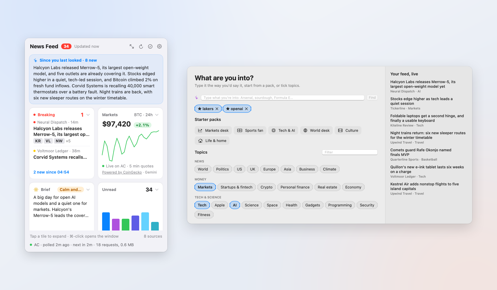
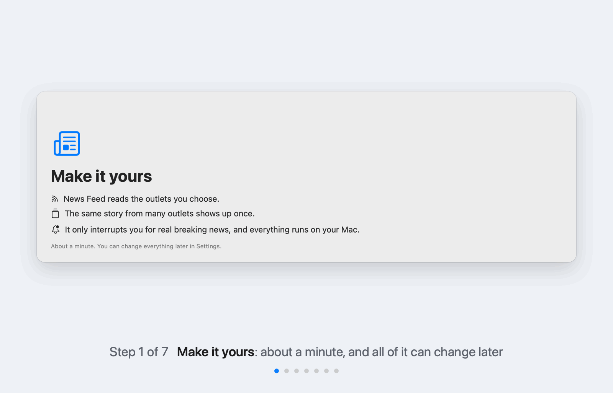
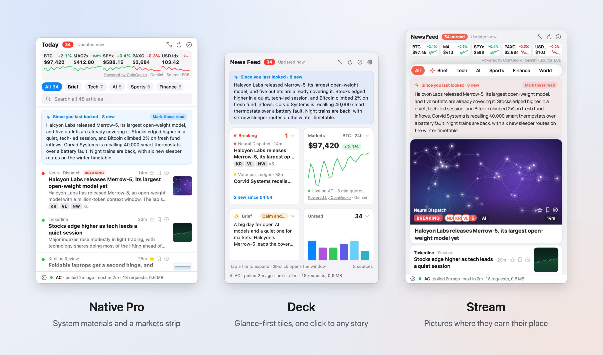
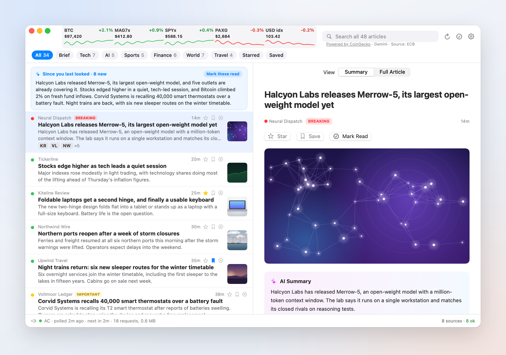
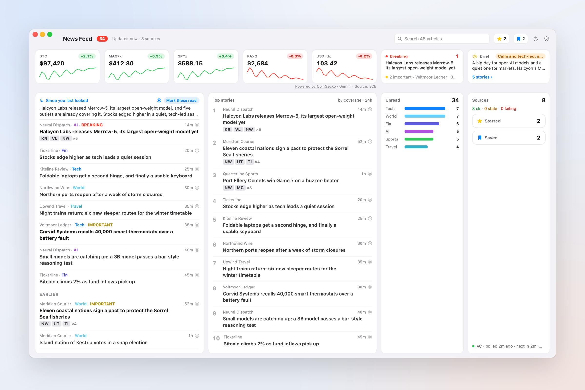
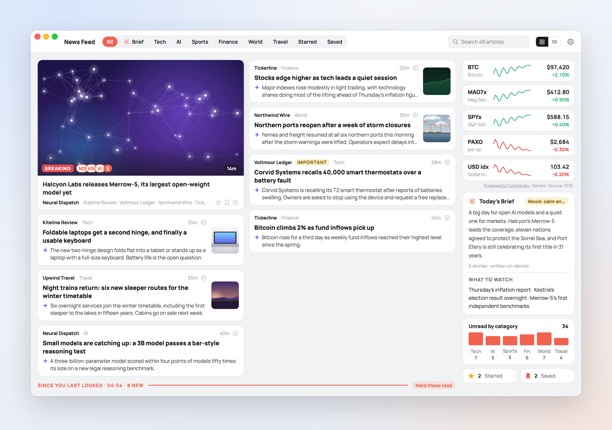
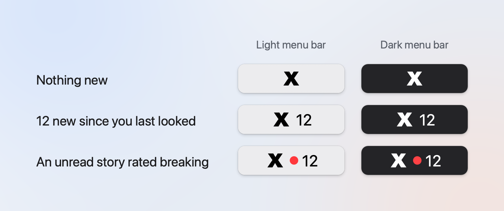

# News Feed

A menu bar news reader for the Mac that reads the outlets you choose, shows a story once however many of them
carry it, and interrupts you only for real breaking news.



News Feed lives in the menu bar. It polls the RSS and Atom feeds of outlets you pick from a checked catalog (or
any site you add), groups the same story from several outlets into one row with the outlets' monograms beside it,
and keeps everything in a SQLite database on your Mac. Breaking news gets its own notification, under a budget of 3
an hour and 10 a day; everything else waits for one recap every 15 minutes (or whatever interval you set). On a
Mac with Apple Intelligence, Apple's on-device model writes the summaries, the recap and a daily brief, and votes on
what counts as breaking.

Free, MIT, no account, no telemetry. It is one person's project, built for and tested on one Mac: read *What it
is not* before you build it.

## What it is not

- **Not a download.** There is no Developer ID behind it, so there is no notarized app to download. You build it
  yourself with Xcode; the steps are in [docs/BUILD.md](docs/BUILD.md).
- **Not widely tested.** Built and tested on one Mac: Apple Silicon (Intel is untested), macOS 27. The bundle
  declares macOS 15 or later, but older systems are untested too.
- **Not dependent on Apple Intelligence, but better with it.** Summaries, the written recap, the daily brief and
  the model's vote on what is breaking need Apple's on-device model (macOS 26 or later, Apple Silicon, and Apple
  Intelligence switched on) or your own Claude API key; sorting typed interests needs the on-device model. Without
  either, everything else works: feeds, grouping, search, the reader, keyword-based breaking alerts, and a recap
  that is a plain list of headlines.
- **Not self-updating.** The Sparkle updater is built in but stays dormant: there is no update signing key yet,
  so it never checks. To update, pull and build again.
- **Not a news service.** There is no server. Every request goes from your Mac straight to the outlet or data
  service it names.

## Make it yours



A fresh install starts with every source off and opens a seven-step welcome, about a minute long:

1. **Welcome.**
2. **Topics.** Starter packs (Markets desk, Sports fan, Tech & AI, World desk, Culture, Life & home) or any of
   62 topics in six groups, plus a box where you can type anything. What the catalog has turns on its sources;
   a name the catalog knows becomes something you follow (and, with the on-device model, other names of people or
   teams too); anything else becomes a Google News search. From here on, a preview pane
   shows real headlines from what you have picked.
3. **Sources.** The outlets each topic turns on, each with its own switch, and "+ Add a site" for anything else.
4. **Follow.** Suggested names for your topics (teams, companies, coins, artists), plus your own. Followed names
   are what can break through as an alert.
5. **Alerts.** Breaking + recap, Recap only, or Quiet; the recap interval; then macOS asks for notification
   permission (not at launch).
6. **Look.** One of the three designs, light, dark or system appearance, and up to five prices (optionally BTC
   in the menu bar).
7. **You're set.** The first headlines waiting, Open at login, and the two optional free keys.

Only Topics needs a choice; the steps after it can be skipped. Nothing is written until you finish, so closing the
window halfway applies nothing. Settings › General › **Run the welcome again** reopens it on your current settings.

## Three looks



| Design | What it is |
|---|---|
| **Native Pro** | The familiar three surfaces with a markets strip and unread counts, all in system materials. |
| **Deck** (the default) | Glance-first tiles; a tile expands in place, so any headline is one click away. |
| **Stream** | Pictures only where they earn it: a hero card for breaking news, cards for stories many outlets carry, rows for the rest. |

Each design has its own popover, main window, settings window and headline widget. The design is read once at
launch, so switching it in Settings › General › Design relaunches the app (about a second).





## The menu bar



| You see | It means |
|---|---|
| The X (or the icon you picked in Settings › General › Icon) | The app is running; click it for the popover. |
| A number beside it | Stories that arrived since you last closed the popover (shown as 99+ above 99). |
| A red dot | An unread story the on-device model rated *breaking*. |
| A green or red "BTC +1.8%" capsule | Optional (Settings › Power › Menu bar), and only while the Mac is on power. |

Settings › Power › Menu bar can also animate the X (a coloured outline turning in four quadrants; off by default).

## What it interrupts you for

There are two kinds of notification, never one per story:

- **An urgent alert, at once**, for a story that matches one of the urgent rules or that the on-device model
  rates breaking, and for a big move in a price you chose (±2.5 % for SPY, QQQ and MAG7, on the day with a
  Finnhub key and over a rolling 24 hours with the keyless prices; ±7 % in 24 hours for BTC, ETH, SOL and XRP;
  once per move). The urgent rules are world events (a war breaking out, a ceasefire, a coup), each topic's own
  big news while that topic is on (an exchange hack under Crypto, a frontier model launch under AI, tour dates
  under Music), and anything major (a trade, a signing, a launch) about a name you follow. At most 3 an hour and
  10 a day: a story over that budget waits for the recap; a market move over it is not sent, and stays latched
  until the move falls back.
- **One recap** every 15 minutes by default, only when something new arrived: "What's new · 12 stories", with the
  lead headlines in the banner's second line and a "Mark these read" button.

Words like "rumor", "reportedly" or "opinion" demote a match, and every rule is editable as text in Settings ›
Notifications. The full rules, with every number, are in [docs/HOW-IT-DECIDES.md](docs/HOW-IT-DECIDES.md).

## The catalog

The bundled catalog has 62 topics in six groups (News, Money, Tech & Science, Sports, Culture, Life) under 17
categories, and 351 sources. The app's own fetcher and parser fetched 345 of the feeds without an error when the
catalog was last checked (2026-10-22); the welcome flow offers only those and the three JSON sources (Formula 1
results and schedule, and NBA live scores with a key). One firehose, arXiv's cs.AI listing, is offered switched
off. `make check-catalog` re-checks every feed.

Outlet names belong to their owners; News Feed reads their public feeds and is not affiliated with them.

F1 schedule and results: [Jolpica F1](https://github.com/jolpica/jolpica-f1), data under
[CC BY-NC-SA 4.0](https://creativecommons.org/licenses/by-nc-sa/4.0/); that data is for non-commercial use only, so
a fork that is sold or carries ads cannot rely on it. Hacker News is read through the RSS feed the site advertises
in its own pages, every 15 minutes; Y Combinator's terms bar "robots, scraping" of the site in general and grant
nothing for that feed in words, so the source is kept with that caveat (unlike Google News below, whose feed says
what it is for).

A topic the catalog lacks becomes a [Google News](https://news.google.com) RSS search for your region. Google
publishes that feed "solely for the purpose of rendering Google News results within a personal feed reader for
personal, non-commercial use", which is what the app does with it. Google's robots.txt disallows `/rss/` for
crawlers; a reader fetching the feed its user asked for is not crawling, but that point is not settled.

## Prices and live games

Prices are off until you choose up to five of BTC, ETH, SOL, XRP, SPY, QQQ, MAG7, Gold, Oil, DXY and EUR/USD.
Everything works without a key:

| Job | Without a key | With your own free key |
|---|---|---|
| Coins | CoinGecko every 2 minutes, plus Gemini's live stream while on power | (no key needed) |
| Stocks and gold | CoinGecko's tokenized copies, labelled so: SPYx, QQQx, MAG7x, PAXG; their change is a rolling 24 hours | [Finnhub](https://finnhub.io/register): real exchange quotes (SPY, QQQ, MAGS for MAG7, GLD for gold) |
| Oil | not available | Finnhub, through USO |
| The dollar | the ECB's daily reference rates: EUR/USD, and a dollar index computed from them, labelled "USD idx" | Finnhub, through UUP (EUR/USD stays on the ECB) |
| NBA scores | news and results from your sources | [balldontlie](https://app.balldontlie.io/): live scores for the teams you follow, every minute while they play |

Both keys are free and take about a minute: sign up, copy the key, paste it into the card in the welcome flow or in
Settings › Power › Data sources, and press Test. Stock and other quotes are fetched every 5 minutes on power and
every 30 on battery, never on a critically low battery.

Credits, as each service asks: **Powered by CoinGecko** (coins, and the tokenized stocks and gold), **Source:
ECB** (EUR/USD and the computed index), **Data provided by Gemini** (the live coin stream), **Quotes: Finnhub**
with a Finnhub key. The line that applies sits beside the prices in every design, and in full in Settings › Power
› Data sources. CoinGecko owns its data and is not liable for it, and crypto prices are volatile; nothing in this
app is financial advice. Each service's terms are summarised in [THIRD_PARTY_NOTICES.md](THIRD_PARTY_NOTICES.md).

Left out of this build: Yahoo Finance quotes, ESPN's scores API and Binance's price stream. Yahoo's and ESPN's
terms do not allow use by a public app, and Binance's bar users in the US and some other countries, so this build
carries no client for any of them; the keyless sources and the two free keys above replace them.

## Privacy

- **Everything stays on your Mac.** Stories, read marks, follows and settings live in
  `~/Library/Application Support/PulseFeed/` and the app's preferences. There is no account, no analytics and no
  server of this project's.
- **What goes out:** requests to the feeds you switched on, to the outlets' article pages (the reader, and on power
  a social-card image for up to 8 picture-less stories a check), to Google News for your searches, and to the price
  and score services above for what you chose.
- **Your keys stay on this Mac.** The Finnhub and balldontlie keys are files in that folder, readable only by your
  user, and each is sent only to its own provider.
- **An optional Claude API key.** Settings › Intelligence takes an Anthropic API key, stored in the same folder as
  `.claude-api-key`. With one, Claude is the fallback whenever the on-device model is unavailable or gives no usable
  answer, for summaries, the recap and the daily brief (and the first choice for summaries and the brief if you
  switch off "Prefer on-device Apple model"). Headlines, and for a summary the first 500 characters of the story,
  are then sent to Anthropic's API. Without a key, no story leaves the Mac for a model. Typed interests are only
  ever sorted on-device.

## Build it yourself

You need a Mac (Apple Silicon; Intel is untested) and Xcode (`xcode-select -p` must point at Xcode, not the
Command Line Tools). No password and no Apple Developer account are needed. Then:

```sh
git clone https://github.com/XBTDMT/XBT-News-Feed.git
cd XBT-News-Feed/PulseFeed
make run        # builds, bundles, signs ad hoc and opens build/PulseFeed.app
make install    # installs /Applications/News Feed.app
```

[docs/BUILD.md](docs/BUILD.md) has the details: tests, a stale notification icon (`make fix-icon`), where the
data lives and how to remove it.

## About the source

The project's internal name is PulseFeed: the Swift package, the binary, the data folder and the bundle identifier
`com.pulsefeed.app` use it. Comments in the code cite the project's design notes (spec sections, decision ids like
`G-2`), which are kept privately and are not part of this repository; the code and tests stand on their own.

## License

MIT, see [LICENSE](LICENSE). Bundled and linked third-party work (Readability.js, the Manrope font, the Swift
packages) and the data services the app calls are listed in [THIRD_PARTY_NOTICES.md](THIRD_PARTY_NOTICES.md).
